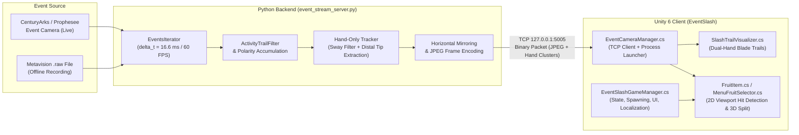

# EventSlash

**EventSlash** is a 3D *Fruit Ninja*-inspired arcade game built in **Unity (Universal Render Pipeline)** and controlled in real time using a neuromorphic **Event Camera** (CenturyArks SilkyEvCam / Prophesee Metavision). Instead of conventional RGB frames, the game processes asynchronous per-pixel brightness change events ($\text{ON}/\text{OFF}$ polarity spikes) at microsecond resolution to detect and track fast hand slashes with low latency.

---

## Key Features

- **Dual Operation Modes**:
  - **Live Camera (`LIVE CAMERA` / `KAMERA LIVE`)**: Streams events directly from a connected CenturyArks / Prophesee event camera.
  - **Offline Playback (`OFFLINE MODE — RAW FILE` / `TRYB OFFLINE — PLIK RAW`)**: Loops pre-recorded Metavision `.raw` event files for testing, calibration, and development without hardware attached.
- **Hand-Only Neuromorphic Tracking Pipeline**:
  - Multi-stage spatial-temporal filtering (`ActivityFilter`, global full-body sway rejection, arm-chain pruning, core-thickness validation, and distal hand-tip extraction).
  - Enforces a strict **"no hand detected → no registration"** rule so head movement, elbows, forearms, and camera shake do not trigger false slices.
  - Supports **1 or 2 hands** simultaneously with independent katana blade trails.
- **Mirrored Interactive Video Feed**:
  - Displays the live event stream in the background of the 3D scene (horizontally mirrored like a natural mirror) while 3D fruits and bombs arc across the foreground.
- **3D Gameplay & Visual Effects**:
  - Custom 3D models created in Blender (`Watermelon`, `Apple`, `Orange`, `Banana`, `Bomb`), each consisting of a whole mesh (`_Whole`) and two sliced halves (`_Half_A`, `_Half_B`).
  - Dynamic slice separation physics, juice splatter particles, bomb explosions, and *Fruit Ninja*-style combo banners.
- **Configurable Settings & Bilingual UI (`English` / `Polski`)**:
  - Three settings tabs (**General / Ogólne**, **Tracking / Śledzenie**, **Game / Rozgrywka**) with a per-tab **Default / Domyślne** reset button.
  - Option to disable lives/hearts (`[✔] ♥` / `[✖] ♥`) for endless practice mode without losing on dropped fruits.

---

## System Architecture

EventSlash uses a **two-process architecture** connected via a local low-latency binary TCP stream (`127.0.0.1:5005`). This decouples the native C++/Python **Prophesee Metavision HAL/SDK** from the **Unity** game engine.



---

### 1. Python Event Processing Server (`PythonBackend/event_stream_server.py`)

The Python backend reads raw event packets `(x, y, p, t)` using `metavision_core.event_io.EventsIterator` at `60 FPS` (`delta_t = 16666 μs`) and performs:

1. **Spatio-Temporal Denoising**:
   - Applies `metavision_sdk_cv.ActivityNoiseFilterAlgorithm` (or a fast spatial-grid density filter fallback) to strip isolated sensor background noise.
2. **Event Frame Rendering**:
   - Accumulates ON (`p = 1`) and OFF (`p = 0`) events into a visual frame with exponential temporal decay so fast motion leaves a crisp visible silhouette.
3. **Hand-Only Detection & Tracking (`HandTracker`)**:
   - Downsamples active event counts into a spatial grid (`10x10 px` cells) and extracts connected components.
   - **Global Sway Suppression**: Rejects frames where a large fraction of the grid moves coherently at low speed (e.g., walking or leaning in front of the camera).
   - **Arm-Chain Pruning & Core-Thickness Check**: Breaks apart long arm/torso bridges using a higher density threshold and requires a compact high-density palm/finger core (`min_thickness`).
   - **Distal Hand-Tip Extraction**: Locates the extremity of the cluster farthest from the body/arm centroid so the tracked cursor stays locked onto the hand rather than the wrist or elbow.
   - **Kalman-like Smooth Trackers**: Maintains persistent velocity-smoothed tracks (`HandTrack`) and only marks a track as an active slashing hand once its speed exceeds `min_speed` (default `155 px/s`).
4. **Horizontal Mirroring**:
   - Flips both the rendered image and normalized hand coordinates `(x, vx)` horizontally (`x = 1.0 - x`, `vx = -vx`) so the player's movements on screen match a real mirror.

---

### 2. Binary TCP Protocol (`Python → Unity`)

For every frame (`~60 Hz`), `event_stream_server.py` sends a compact binary packet over TCP (`127.0.0.1:5005`) in Little-Endian format:

| Offset | Type | Description |
| :--- | :--- | :--- |
| `0` | `uint32` | Magic header `0x45564E54` (`"EVNT"`) |
| `4` | `uint32` | JPEG image payload byte length (`N`) |
| `8` | `float32` | Primary hand normalized `X` (`0.0 .. 1.0`, `-1.0` if no hand) |
| `12` | `float32` | Primary hand normalized `Y` (`0.0 .. 1.0`, top-to-bottom) |
| `16` | `float32` | Primary hand velocity `Vx` (`px/s`) |
| `20` | `float32` | Primary hand velocity `Vy` (`px/s`) |
| `24` | `float32` | Primary hand motion intensity (`0.0 .. 1.0`) |
| `28` | `uint32` | Number of active tracked hands `K` (`0`, `1`, or `2`) |
| `32` | `K × 20 B` | Per-hand records: `float32 x, y, vx, vy, radius` |
| `32 + K×20` | `N bytes` | Compressed JPEG frame of the event camera view |

---

### 3. Unity Client Architecture (`Unity/EventSlash/Assets/Scripts/`)

| Script | Responsibility |
| :--- | :--- |
| `EventCameraManager.cs` | Reads `config.txt`, automatically launches `event_stream_server.py` as a background subprocess with the configured CLI flags (`--min-speed`, `--min-thickness`, `--max-hands`, `--sway-filter`, `--denoise`), decodes incoming TCP packets on a background thread, updates the background `Texture2D`, and exposes `CheckFruitSliced()` for 2D segment-circle intersection tests. |
| `EventSlashGameManager.cs` | Manages the game lifecycle (`MainMenu`, `Playing`, `GameOver`), fruit and bomb wave spawning, combo scoring, lives/hearts system, persistent `PlayerPrefs` settings, and runtime bilingual localization (`English` / `Polski`). |
| `MenuFruitSelector.cs` | Controls the 3D rotating fruits inside the main menu neon rings (`LIVE CAMERA` and `OFFLINE MODE / RAW FILE`), rebuilds curved arc text when switching languages, and starts the selected mode when the ring's fruit is sliced. |
| `FruitItem.cs` | Controls ballistic trajectories of launched 3D fruits and bombs, queries `EventCameraManager.Instance.CheckFruitSliced()`, spawns `SlicedFruitHalf` prefabs (`Half_A` and `Half_B`) oriented along the slash angle, and triggers particle effects. |
| `SlicedFruitHalf.cs` | Simulates gravity and angular rotation on the two separated fruit halves after a slice. |
| `SlashTrailVisualizer.cs` | Matches up to 2 simultaneous hand tracks across frames using nearest-neighbor assignment and renders glowing katana `TrailRenderer` paths in world space. |
| `EventScreenFitter.cs` | Scales the background `EventCameraScreen` quad to match the orthographic camera's aspect ratio. |
| `Editor/EventSlashSceneBuilder.cs` | Editor utility (`EventSlash → Rebuild Complete Scene & Assets`) that procedurally generates textures, URP materials, fruit prefabs, lighting, canvases, and the complete scene hierarchy. |

---

## Repository Structure

```text
EventSlash/
├── config.txt                                 # Device-specific paths (PYTHON_EXE and RAW_FILE)
├── README.md                                  # Project documentation and architecture guide
├── Blender/
│   ├── EventSlash_Fruits.blend                # Blender source file for 3D fruit models
│   └── create_bomb_models.py                  # Script for generating whole & split bomb FBX meshes
├── PythonBackend/
│   ├── event_stream_server.py                 # Python Metavision TCP server & hand tracker
│   ├── start_env.bat                          # Helper batch script to test Metavision environment
│   ├── test_live.py / test_offline.py         # Standalone Metavision camera test scripts
│   ├── raw_recordings/                        # Folder for .raw recordings (ignored by Git)
│   └── Sterowniki do kamery eventowej/        # Installers for Prophesee SDK & CenturyArks plugins
└── Unity/
    └── EventSlash/                            # Unity 6 (6000.3.11f1) URP Project
        ├── Assets/
        │   ├── Fonts/                         # Custom Ninja UI fonts
        │   ├── Materials/                     # URP materials for fruits and camera screen
        │   ├── Models/Fruits/                 # FBX models (Whole, Half_A, Half_B)
        │   ├── Prefabs/Fruits/                # Configured fruit & bomb prefabs
        │   ├── Scenes/SampleScene.unity       # Main game scene
        │   └── Scripts/                       # Runtime and Editor C# scripts
        └── ProjectSettings/
```

---

## Setup & Running on Another Device

When cloning this repository onto a new Windows machine, follow these steps:

### 1. Install Event Camera Drivers & Metavision SDK
1. Install the **Prophesee Metavision SDK** (default path: `C:\Program Files\Prophesee`) and **CenturyArks SilkyEvCam plugin** (`C:\Program Files\CenturyArks\plugins`) from `PythonBackend/Sterowniki do kamery eventowej/`.
2. Create a Python virtual environment (`.venv`) compatible with your installed Metavision Python bindings (e.g., inside `PythonBackend/.venv`) and install `numpy` and `opencv-python`:
   ```powershell
   pip install numpy opencv-python
   ```

### 2. Add a `.raw` Recording (for Offline Mode)
Place at least one `.raw` recording inside:
```text
PythonBackend/raw_recordings/
```

### 3. Update `config.txt`
Edit `config.txt` in the root folder of the repository to point to your Python executable and `.raw` file:
```ini
PYTHON_EXE = C:\path\to\your\.venv\Scripts\python.exe
RAW_FILE = your_recording.raw
```
*(Note: If `PYTHON_EXE` points to the default `PythonBackend/.venv/Scripts/python.exe`, it will be detected automatically even if the project is in a different user directory.)*

### 4. Open in Unity & Play
1. Open `Unity/EventSlash` in **Unity 6** (`6000.3.x` with Universal Render Pipeline).
2. Open `Assets/Scenes/SampleScene.unity` (or run **EventSlash → Rebuild Complete Scene & Assets** from the top menu bar if you want to regenerate all prefabs and UI from scratch).
3. Press **Play**:
   - Slice the **left watermelon** (`LIVE CAMERA`) to play using a connected event camera.
   - Slice the **right orange** (`OFFLINE MODE / RAW FILE`) to play using the `.raw` file configured in `config.txt`.
   - Click the **top-right gear icon** to adjust language (`English` / `Polski`), hand tracking thresholds, or gameplay rules.
